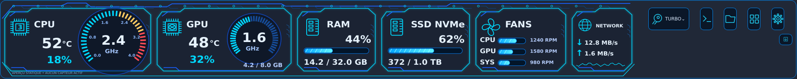

# Health & Perfs — Navigation Controller Bar

Socle natif **v0.2.0**, inspirée du prototype HUD bleu électrique de Flo.
Une barre de bureau transparente, sur toute la longueur de l’écran, avec ses commandes
**visibles tout à droite**. Aucune mini-navbar invisible.



**V0.2 livrée en branche** : télémétrie read-only, 7 packs ZIP de sondes, cinq onglets, longueur et alignement, glisser-déposer des modules, scripts Shell locaux. Les limites et éléments non finalisés sont détaillés dans [Changelog v0.2](docs/V0.2.md).

## Ce qui fonctionne

- Fenêtre sans bordure, au-dessus des autres fenêtres ; dessin vectoriel haute résolution.
- Cadres CPU / GPU / RAM / SSD / ventilateurs / réseau et jauges **statiques de démonstration**.
- Boutons à droite : Turbo (menu réservé), console (réservée), dossier, extensions, réglages.
- Première ouverture guidée : écran, position haut / bas / droite, épaisseur, opacité des modules,
  rétractation et lancement à l’ouverture de session.
- Rétractation après 15 secondes sans survol ; bord de rappel de 4 px ; retour au survol.
- Bouton carré avec flèche pour agrandir la barre. Affichage compact aux petites résolutions.
- Préférences et extensions séparées pour chaque compte utilisateur ; une instance par compte.
- Gestionnaire d’extensions locales : ajout, mise à jour, activation, désactivation, retour à la version précédente.

**Sept packages de plugins capteurs** sont générés via `python scripts/build_plugins.py`. Leur ZIP peut être importé par le gestionnaire API v2. L’application dispose d’un collecteur matériel en lecture seule ; la disponibilité des températures, des ventilateurs et du GPU dépend des pilotes et de l’OS. Les boutons Turbo et contrôle PWM restent sans action matérielle.

Le téléchargement de plugins depuis un store VPS et la pose automatique de leurs dépendances ne sont pas encore opérationnels.

## Installer

Les builds du workflow [Native installers](../../actions/workflows/build.yml) produisent :

| Système | Paquet | Installation |
| --- | --- | --- |
| Linux x86_64 | `.tar.xz` | Extraire, lancer `Install.sh` |
| Windows 10/11 x64 | `HealthPerfsBar-Setup-Windows.exe` | Assistant sans droits administrateur |
| macOS Apple Silicon | `.dmg` | Glisser l’app dans Applications et l’ouvrir |

Ces paquets sont des artefacts GitHub Actions, pas encore une release signée.
Les builds Windows et macOS doivent être vérifiés sur leurs systèmes respectifs.

**Depuis les sources**, avec Python 3.10+ et Internet :

- Linux : `sh Install-Linux.sh` (installer `python3-venv` si nécessaire).
- Windows : double-cliquer sur `Install-Windows.cmd`.
- macOS : ouvrir `Install-macOS.command` (ou `sh Install-macOS.command` dans Terminal).

Le script installe une copie de l’application dans un environnement privé persistant,
ajoute un lanceur, puis ouvre les préférences. Aucun `sudo`, aucune modification du Python système.
Le démarrage automatique est une option explicite, désactivée par défaut.

Voir [Installation, démarrage et compatibilité](docs/INSTALLATION.md).

## Développer

```sh
python3 -m venv .venv
.venv/bin/python -m pip install -e .
.venv/bin/python -m healthbar
.venv/bin/python -m healthbar --setup
QT_QPA_PLATFORM=offscreen .venv/bin/python -m unittest discover -s tests -v
.venv/bin/python -m healthbar --preview docs/preview.png
```

Sous Windows, remplacer `.venv/bin/python` par `.venv\Scripts\python.exe`.

- [Architecture et arborescence](docs/ARCHITECTURE.md)
- [Contrat des futurs plugins et mises à jour](docs/PLUGINS.md)
- [État de validation](docs/VALIDATION.md)

## Limites de cette première version

Linux X11 est la cible initiale. Sous Wayland/Bazzite, le compositeur peut refuser le
positionnement absolu ou le maintien au premier plan ; l’intégration layer-shell reste à développer.
Cette base Qt 6 ne prend pas en charge Windows 7. Un port legacy séparé est nécessaire.
Les anciens Mac Intel ne sont pas couverts par le DMG arm64 ; le lancement source dépend
de la compatibilité Python/Qt de la machine. Aucun support multiutilisateur administrateur « tous comptes »
n’est installé : chaque utilisateur lance son propre assistant.

Le dessin reprend la composition, les teintes et les modules du prototype avec des formes vectorielles ;
ce n’est pas une reproduction photographique pixel par pixel. La lisibilité et les boutons
s’adaptent à l’écran, avec un agencement vertical distinct à droite.
