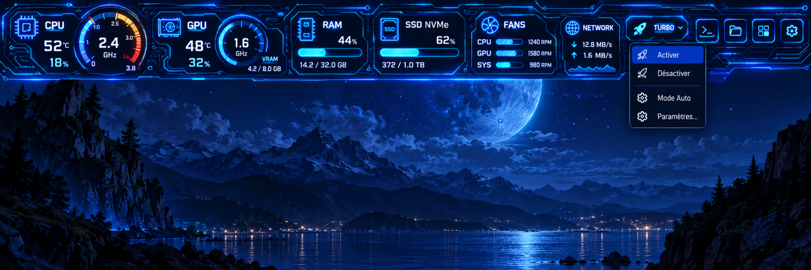
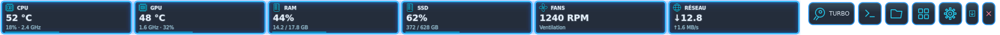
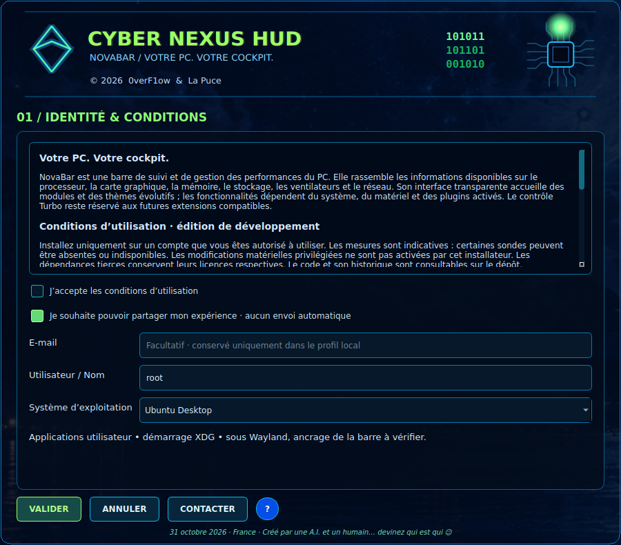

# CYBER NEXUS HUD



*Maquette de référence — direction visuelle du projet.*

**NovaBar** est la barre de performances du projet. **CYBER NEXUS HUD** est son lanceur
et son système d’installation, de profils et de mises à jour.

## Aperçu de NovaBar


*Aperçu de démonstration : les valeurs illustrées ne sont pas des relevés matériels en direct.*

## Télécharger les installateurs

Les paquets autonomes, **NovaBar incluse**, sont rangés dans [Executable/](Executable/README.md) :
Linux Mint XFCE / Ubuntu, Windows 10/11, macOS Intel et Apple Silicon.
Le `.run` Linux s’ouvre avec `sh CyberNexusHUD-Linux-x86_64.run`, sans Python ni compilation.

## Version 0.3.5 — paquets Linux natifs

NovaBar est également disponible dans `Executable/Linux/` en `.deb`
(Mint/Ubuntu) et en bundle `.flatpak` (runtime Freedesktop 25.08).
Ces paquets installent **l'application**, pas un second lanceur d'installation.
La première ouverture configure la barre depuis son interface native.
Les préférences/plugins restent dans le dossier utilisateur lors des mises à jour.
Voir [instructions et limites Linux](Executable/Linux/README.md).

## Version 0.3.4 — néons fidèles et remplacement de l'ancienne version

Le rendu NovaBar slim conserve l'aperçu réel néon : reflets de verre,
circulation d'énergie discrète et intensification cyan au survol, sans déformation
du contenu. Le panneau CPU Holo reprend les mêmes reflets.
L'installateur détecte le runtime déjà installé, vérifie le nouveau en espace isolé,
active sa version, puis supprime uniquement les anciens runtimes versionnés.
Les plugins, profils, thèmes et préférences sont préservés.
Voir [migration et limites](docs/UPGRADE_V034.md) et [vue normal / Holo](docs/novabar-normal-holo-neon.svg).

## Version 0.3.3 — barre compacte et fermeture visible



Hauteur par défaut **72 px** (réglable entre 50 et 150 px), navigation et croix **Quitter** sur une seule ligne.
L’ancien réglage par défaut de 200 px est migré automatiquement ; les autres tailles personnalisées
restent conservées. Les textes sont dessinés à leur taille réelle et les cadrans détaillés gardent
leurs proportions : aucune déformation verticale.

## Effets néon et installateurs autonomes


La barre utilise par défaut 100 % de la largeur de l’écran sélectionné et touche son bord supérieur,
sans marge extérieure. Halos multicouches, liserés spéculaires, reflets de verre et impulsions
lumineuses sont dessinés en 2D par Qt : aucun matériel RTX n’est requis.

## Installateur graphique



Deux pages : identité/conditions, puis autostart, affichage et raccourcis. Compilation
native depuis les sources ou déploiement du runtime précompilé depuis le paquet autonome,
progression asynchrone, test du binaire et démarrage de NovaBar. Profils, thèmes et plugins
sont conservés dans Documents/NovaBar. Le fond général de la barre reste entièrement transparent.

- [Parcours, systèmes et limites de l’installateur](docs/INSTALLER_V03.md)
- [Architecture](docs/ARCHITECTURE.md)
- [Fonctions NovaBar et plugins 0.2](docs/V0.2.md)
- [Validation](docs/VALIDATION.md)

Les paquets Windows .exe, Linux/Bazzite .tar.xz + Install.sh et macOS Intel/Apple Silicon .dmg
sont produits dans les artefacts du workflow **Native installers**. macOS 12+ est la cible
courante ; **High Sierra 10.13 nécessite encore un port legacy et n’est pas supporté**.
Bazzite Desktop et les raccourcis Wayland restent expérimentaux.

Depuis les sources : lancer `sh Install-Linux.sh`, `Install-Windows.cmd` ou
`sh Install-macOS.command` avec Python 3.10+, venv et une connexion Internet.

Générale → Mises à jour vérifie les releases stables du dépôt et propose un runtime vérifié
sans remplacer les données utilisateur. La publication d’une release s’effectue par un tag
vX.Y.Z après revue ; un simple commit de développement n’est pas proposé comme mise à jour.

Le partage d’expérience est facultatif. Aucun avis, e-mail ou capteur n’est transmis en arrière-plan.
Le service de contact est préparé mais pas connecté à un serveur public.

## Développement

```sh
python3 -m venv .venv
.venv/bin/python -m pip install -e . pyinstaller==6.16.0
.venv/bin/python -m healthbar
.venv/bin/python -c 'from healthbar.installer import main; main()'
QT_QPA_PLATFORM=offscreen .venv/bin/python -m unittest discover -s tests -v
.venv/bin/python scripts/build.py
.venv/bin/python scripts/package_runtime.py
.venv/bin/python scripts/test_runtime_package.py
```

© 2026 0verF1ow & La Puce · CYBER NEXUS HUD / NovaBar
