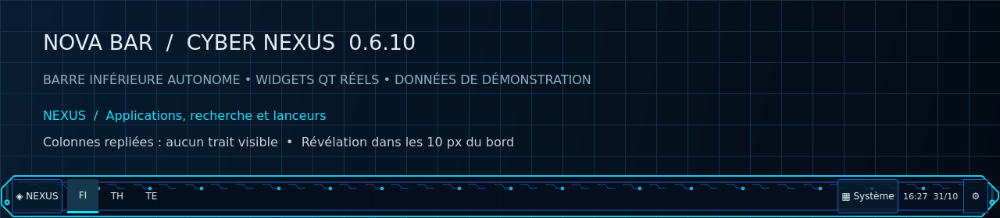
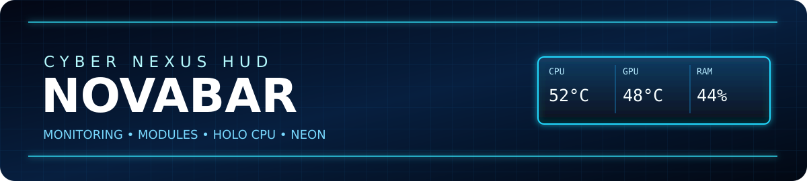
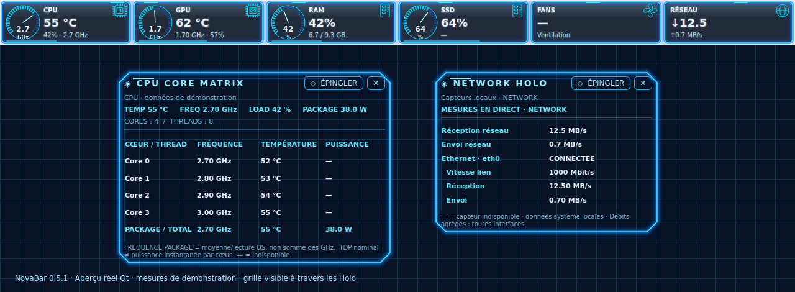
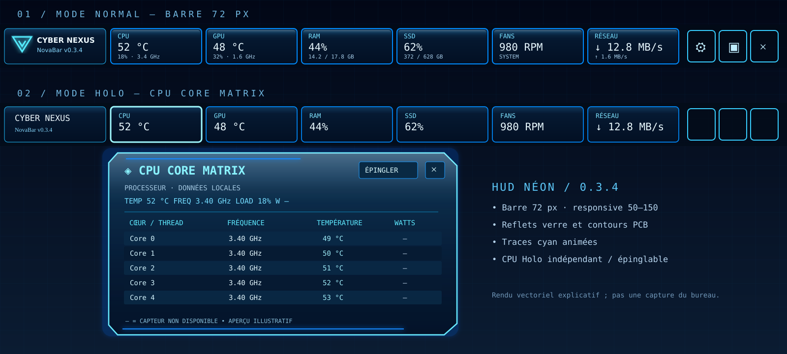
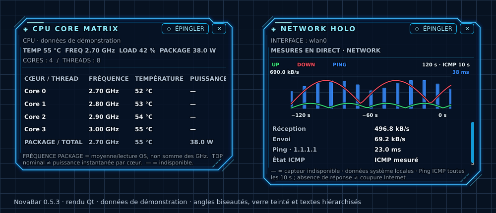
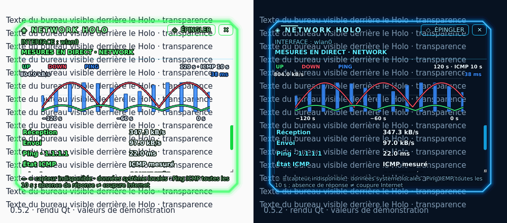
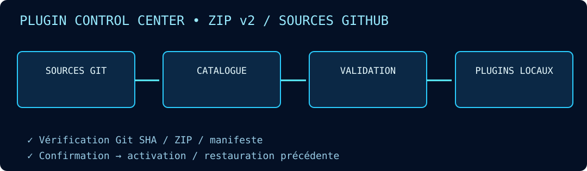
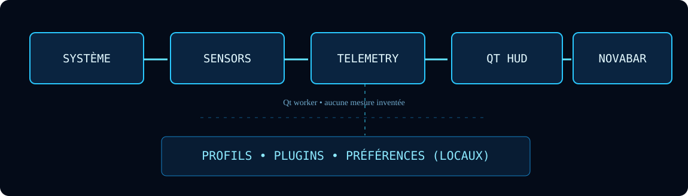

## ⚡ NovaBar 0.6.10 — CYBER NEXUS HUD

Une vraie barre inférieure NovaBar sous Linux/X11 : menu d’applications avec recherche, lanceurs XFCE, fenêtres ouvertes, activation/réduction, horloge et accès aux commandes système. Elle apparaît même si aucun panneau inférieur XFCE n’est détecté.

Le panneau XFCE inférieur est masqué pendant la session et restauré quand NovaBar quitte, sans supprimer sa configuration. Les applets de notification restent hébergées par XFCE : **Système → Afficher les icônes XFCE pendant 30 s** permet d’y accéder.

Les docks latéraux repliés sont **entièrement invisibles** ; ils s’ouvrent dans les **10 px** du bord et se referment 3 s après la sortie. Dans **Paramètres → Upgrade**, NovaBar vérifie, télécharge, teste et active la nouvelle version puis redémarre en conservant les profils et plugins.

[⬇️ Téléchargements 0.6.10](Executable/README.md) · [📖 Notes de version](docs/UPDATE_V0610.md) · [📁 Docks](docs/wiki/Docks.md) · [🔄 Upgrade](docs/wiki/Mises-a-jour.md)



<p align="center">
  
</p>

<h1 align="center">⚡ NovaBar — CYBER NEXUS HUD</h1>
<p align="center"><strong>Votre PC. Votre cockpit.</strong><br>Une barre de performances cyber-néon, compacte, transparente et extensible.</p>

<p align="center">
  
  
  
  
</p>

<p align="center">
  <a href="docs/wiki/Home.md"><strong>📚 WIKI COMPLET</strong></a> ·
  <a href="Executable/README.md"><strong>⬇️ INSTALLATEURS</strong></a> ·
  <a href="docs/wiki/Premiers-pas.md"><strong>🚀 DÉMARRAGE</strong></a> ·
  <a href="docs/wiki/Architecture.md"><strong>🏗️ ARCHITECTURE</strong></a>
</p>

---

## 🌌 Découvrez la NovaBar

<p align="center"></p>
<sub>📸 Aperçu de l'application, avec données d'illustration : les valeurs affichées ne sont pas celles de votre machine.</sub>

NovaBar reste au bord de votre bureau pour exposer les informations pertinentes sans encombrer l'écran : contours PCB cyan, panneaux vitrés, reflets, halo au survol et transparence hors des modules. **72 px** par défaut, **50–150 px** réglables et **100 % de largeur** initialement.

### 🖥️ Les six modules

| 🌡️ CPU | 🎮 GPU | 🧠 RAM | 💾 Stockage | 🌀 Ventilation | 🌐 Réseau |
|:---:|:---:|:---:|:---:|:---:|:---:|
| Charge, °C, GHz | °C, VRAM, charge | Utilisée / libre | Capacité, E/S | Vitesse RPM | Débits montant / descendant |

Les informations proviennent des capteurs du système : une valeur **—** signifie « indisponible », sans simulation trompeuse.

## ✨ L'expérience NovaBar

- **🎨 Mode néon** — halos cyan, reflet de verre, opacité modulable, barre responsive et rétractable.
- **📟 Instruments 0.5.4 (en préparation)** — CPU/GPU et ventilateur en cadrans segmentés sans aiguilles ; GHz/RPM centrés. RAM/SSD en jauges de batterie segmentées, sans compte-tour. En rétractation : données lisibles au bord de l'écran, aucun cadran ni logo Holo.
- **🧠 Holo compacts et transparents** — CPU 460 × 330 px, autres capteurs 380 × 280 px ; détails au clic sur le logo en haut à droite, tableaux défilants sans fond gris ou blanc.
- **🌐 Réseau détaillé** — état, vitesse de lien et débits individuels des interfaces.
- **🧩 Plugin Control Center 2-en-1** — onglets **Plugins / Sources**, ZIP versionnés, sources GitHub configurables et restauration.
- **📐 Barre ajustable** — haut, bas, gauche, droite ; 25–100 % de longueur ; 50–150 px d'épaisseur.
- **🔌 Monitoring local** — collecteur CPU/GPU/RAM/disques/ventilateurs/réseau en lecture seule.
- **📁 Profils préservés** — réglages et extensions indépendants des exécutables.
- **📖 Wiki intégré (0.3.6+)** — bouton **?** dans la barre, dans les préférences, le menu contextuel et la zone de notification.

<p align="center"></p>
<sub>Illustration vectorielle Normal/Holo. Les logos en haut à droite ouvrent les panneaux Holo par clic uniquement. Turbo Linux dépend du noyau et des droits ; aucun contrôle PWM.</sub>

## 🆕 Mise à jour 0.5.3

Fond Holo uni sombre à 85 % d’opacité, cadres néon fins à angles coupés et données en blanc/gris. La couleur du thème souligne les titres et contours ; elle ne recolore plus toutes les écritures des plugins.



[Guide du style et de la palette 0.5.3](docs/UPDATE_V053.md)

## Mise à jour précédente 0.5.2

Holo lisibles sur fond clair grâce au contour sombre des caractères ; réseau avec courbe UP verte, DOWN rouge et histogramme de ping bleu. Petits débits affichés en B/s ou kB/s ; connexion active prioritaire.



*Rendu Qt avec données de démonstration. Les Holo restent transparents.*

[Guide 0.5.2 et limites du ping](docs/UPDATE_V052.md)

## Mise à jour précédente 0.5.1

[Guide de mise à jour](docs/UPDATE_V051.md) · [Guide des Holo](docs/wiki/Holo-CPU.md) · [Captures avec transparence](Assets/README.md).

Les consommations CPU/GPU sont affichées uniquement lorsqu’une sonde les fournit. Les valeurs initiales ou inconnues restent « — ». Les images utilisent des données de démonstration.

## 📦 Télécharger & installer — NovaBar 0.6.10

Les installateurs natifs sont distribués depuis la [release 0.6.10](https://github.com/florian74410/Health-and-Perfs---Navigation-Controler-Bar/releases/tag/v0.6.10) et classés dans [Executable/](Executable/README.md) avec les sommes de contrôle.

| Système | Fichier |
| --- | --- |
| 🐧 Linux Mint XFCE / Ubuntu | [NovaBar_0.6.10_amd64.deb](https://github.com/florian74410/Health-and-Perfs---Navigation-Controler-Bar/releases/download/v0.6.10/NovaBar_0.6.10_amd64.deb) |
| 🪟 Windows 10/11 | [CyberNexusHUD-Setup-Windows.exe](https://github.com/florian74410/Health-and-Perfs---Navigation-Controler-Bar/releases/download/v0.6.10/CyberNexusHUD-Setup-Windows.exe) |
| 🍎 macOS Apple Silicon | [CyberNexusHUD-macOS-arm64.dmg](https://github.com/florian74410/Health-and-Perfs---Navigation-Controler-Bar/releases/download/v0.6.10/CyberNexusHUD-macOS-arm64.dmg) |
| 🍏 macOS Intel | [CyberNexusHUD-macOS-x86_64.dmg](https://github.com/florian74410/Health-and-Perfs---Navigation-Controler-Bar/releases/download/v0.6.10/CyberNexusHUD-macOS-x86_64.dmg) |

Installation sur Linux Mint après téléchargement :

```bash
cd "$(xdg-user-dir DOWNLOAD)"
sudo apt install ./NovaBar_0.6.10_amd64.deb
novabar
```

Une mise à jour native conserve les préférences locales. Les binaires ne sont pas signés ou notarisés. Les tests automatiques ne remplacent pas une validation graphique en session XFCE/X11.

[🔧 Instructions de mise à jour et restauration](docs/UPDATE_V0610.md) · [📦 Installation détaillée](docs/INSTALLATION.md)

## 🧩 Plugin Manager

<p align="center"></p>

Le gestionnaire détecte les **versions installées et disponibles**. Il peut synchroniser plusieurs sources GitHub publiques, installer des ZIP compatibles sans reconstruire le lanceur, activer un module et restaurer la version précédente. Un changement de contrat de capteur/API demande néanmoins une mise à jour du programme.

[🧩 Tout comprendre sur les plugins](docs/wiki/Plugins.md)

## 🏗️ Architecture

<p align="center"></p>

**Python 3.10+ · PySide6 / Qt · psutil · collecteur de sondes · PyInstaller**. Le travail de collecte est dissocié des animations. Les données sont stockées localement, et les extensions utilisent des manifestes inspectés avant installation.

[🏗️ Étudier l'architecture](docs/wiki/Architecture.md) · [📊 Comprendre les capteurs](docs/wiki/Capteurs.md)

## 📚 Wiki et assistance

**La documentation NovaBar complète est hébergée dans [`docs/wiki/`](docs/wiki/Home.md)**, avec un index, des pages détaillées, des illustrations SVG et des guides pratiques. La barre ouvre ces pages GitHub dans votre navigateur (une connexion Internet est nécessaire). Il ne s'agit pas encore du dépôt Git séparé du Wiki natif GitHub.

[🚀 Premiers pas](docs/wiki/Premiers-pas.md) · [🎛️ Interface](docs/wiki/Interface.md) · [🧠 Holo CPU](docs/wiki/Holo-CPU.md) · [⚙️ Configuration](docs/wiki/Configuration.md) · [🛠️ Dépannage](docs/wiki/Depannage.md) · [❓ FAQ](docs/wiki/FAQ.md) · [🤝 Contribuer](docs/wiki/Contribuer.md)

## 🚦 Statut

Projet en développement. La compatibilité des overlays Wayland/Bazzite et le comportement exact des sondes doivent être validés sur les machines réelles. **Turbo Linux via sysfs uniquement si le noyau et les droits le permettent** ; aucun contrôle PWM. Les panneaux Holo restent dépendants des sondes disponibles. Les builds CI vérifient des systèmes de compilation, pas toutes les configurations matérielles.

---

<p align="center"><strong>⚡ CYBER NEXUS HUD / NOVABAR</strong><br><em>Un cockpit discret. Une lecture instantanée.</em></p>

## Nouvelle génération 0.4

Voir [CHANGELOG](CHANGELOG.md). Les sources de développement et les exécutables publiés peuvent avoir des versions différentes ; le manifeste des exécutables reste la référence pour les téléchargements.

## NovaBar Next · sources 0.5.2

Les deux updates sont décrites dans le [changelog](CHANGELOG.md).

- **Update 1 / 0.4.0** : Blue Neon / Green Matrix / Red Blood, routing PCB bord à bord, puce NovaBar, minimisation et onglet Wiki. **Le logo en haut à droite de chaque plugin est le seul déclencheur du Holo** ; un second clic ferme le panneau.
- **Update 2 / 0.5.0** : CPU Mode réel sur Linux compatible, Auto 85 °C avec retour à 80 °C, downloader natif Linux/Windows avec SHA-256 et priorité d’affichage selon OS.

[Downloader et packaging](docs/wiki/Downloader.md) · [CPU Mode et limitations OS](docs/wiki/CPU-Mode.md).

La release **0.5.2** regroupe les nouveaux paquets et leurs manifestes de contrôle SHA-256. Les fichiers historiques dans `Executable/` restent identifiés par leur version ; privilégiez les téléchargements de la release pour cette mise à jour.
