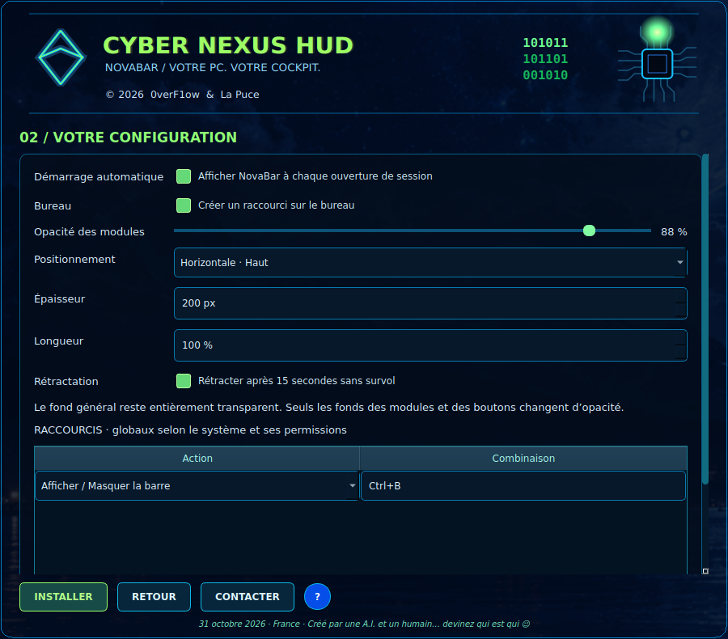

# CYBER NEXUS HUD — installateur de NovaBar 0.3

**Projet et lanceur : CYBER NEXUS HUD. Barre : NovaBar.**




## Parcours

1. En-tête animé : logo vectoriel, vert néon et bleu électrique ; signature binaire
   101011 / 101101 / 001010 ; puce et 16 pistes PCB parcourues d’impulsions colorées.
   Copyright © 2026 0verF1ow & La Puce. Fond dérivé de la partie lac/montagnes de la référence,
   sans inclure sa barre supérieure ; mise à l’échelle conservant les proportions de l’image.
2. Description et conditions défilantes ; acceptation obligatoire non cochée par défaut.
   Partage d’expérience facultatif coché comme demandé, sans collecte ni envoi automatique.
3. E-mail facultatif, utilisateur prérempli, système détecté et liste des cibles.
   L’installation d’un autre OS que celui du lanceur est bloquée, même après sélection.
4. Page 2 : autostart activé par défaut, raccourci bureau optionnel, fonds des modules
   de 0 à 100 %, quatre bords, épaisseur, longueur 100 % par défaut, rétractation.
5. Plusieurs raccourcis configurables, ajout/suppression et sauvegarde/annulation du brouillon ;
   Ctrl+B affiche/masque par défaut. Les doublons sont refusés.
6. Installation dans une version dédiée, test isolé du vrai exécutable et vérification de son
   numéro de version. Le profil et les lanceurs sont activés après ce test. Succès :
   message avec coche verte, fermeture de l’assistant et ouverture de NovaBar.

## Compilation et paquets

Depuis les sources (`Install-Linux.sh`, `Install-Windows.cmd`, `Install-macOS.command`),
le bootstrap prépare le lanceur dans un environnement Python privé. L’assistant compile
ensuite NovaBar avec PyInstaller pour le système hôte, dans un second environnement temporaire.
Le rapport et la progression distinguent préparation, dépendances, compilation, test et activation.
Python 3.10+, venv et Internet sont requis pour ce chemin.

Les paquets autonomes embarquent déjà le runtime compilé pour leur OS et architecture :
ils l’installent sans retélécharger Python ni reconstruire Qt. Il ne s’agit pas d’une
compilation personnalisée du code sur la machine dans ce mode ; les choix utilisateur
personnalisent le profil. Un installateur autonome contient le programme qu’il doit installer.

| Paquet | Cible |
| --- | --- |
| CyberNexusHUD-Setup-Windows.exe | Windows 10 (1809+)/11 x64 ; assistant Inno déploie le lanceur graphique |
| CyberNexusHUD-Linux-x86_64.tar.xz, Install.sh | Mint XFCE / Ubuntu x64 |
| CyberNexusHUD-Bazzite-x86_64.tar.xz, Install.sh | Même runtime Linux ; profil Bazzite Desktop, installation utilisateur et XWayland expérimental |
| CyberNexusHUD-macOS-arm64.dmg | macOS 12+ Apple Silicon |
| CyberNexusHUD-macOS-x86_64.dmg | macOS 12+ Intel |

Ouvrir le DMG puis CyberNexusInstaller.app pour installer NovaBar. Sous Linux extraire
l’archive et lancer `sh Install.sh`. Sous Windows ouvrir le Setup puis le lanceur proposé.
Le raccourci permanent ouvre **NovaBar**, pas l’assistant.

**High Sierra = macOS 10.13** : cible affichée mais non installable avec cette édition Qt 6.8.
Un port legacy reste nécessaire ; aucun paquet High Sierra fonctionnel n’est fourni.
Windows 7 ne fait plus partie des cibles demandées. Sous Bazzite, le lanceur ne modifie
pas /usr et n’utilise pas rpm-ostree ; le mode Gaming n’est pas pris en charge.
L’ancrage Wayland dépend encore du compositeur ; XWayland est sélectionné si DISPLAY existe.

## Données conservées

```text
Documents/NovaBar/
  App/Profiles/<compte-OS>.json   profil complet : identité, consentements, préférences, installation
  Profiles/<compte-OS>.json       copie accessible du même profil
  Plugins/                       paquets installés et versions précédentes
  Themes/                        espace réservé aux thèmes utilisateur
  Reports/installation.log
  Reports/update.log
  Updates/
```

Les préférences actives restent dans le répertoire de configuration existant pour compatibilité.
Leur enregistrement actualise les copies de profil. Les plugins préexistants sont copiés
vers Documents/NovaBar/Plugins à la première utilisation, sans supprimer leur ancien dossier.
Le choix d’expérience et l’adresse e-mail sont modifiables dans Générale → Profil,
confidentialité et raccourcis. Les anciennes fiches Profile.md restent disponibles.

Les exécutables versionnés sont indépendants :

- Linux : ~/.local/share/novabar/versions/<version>
- Windows : %LOCALAPPDATA%/NovaBar/versions/<version>
- macOS : ~/Library/Application Support/NovaBar/runtime/versions/<version>

Chaque compte possède son installation et son autostart (XDG, HKCU ou LaunchAgent).
Sur macOS un lien ~/Applications/NovaBar.app ouvre la version installée.

## Raccourcis et transparence

Le fond général reste transparent, sans rectangle global.
Ctrl+B et les autres combinaisons sont enregistrés avec X11 sur Linux, ou pynput
sur Windows/macOS. macOS peut exiger une autorisation d’accessibilité. En session
Wayland ou sans accès aux raccourcis globaux, le logiciel passe en mode local et
l’indique dans l’infobulle du bouton Turbo ; l’icône de notification permet toujours
l’affichage de la barre. L’intégration aux raccourcis du compositeur reste à développer.

## Mise à jour sans réinstallation des données

Générale → Mises à jour : vérification explicite de la dernière release stable GitHub,
comparaison avec la version embarquée, proposition puis téléchargement sur confirmation.
Le paquet est celui de l’OS et de l’architecture exécutés, jamais celui d’une sélection arbitraire.
L’archive runtime ne contient ni profil, ni thème utilisateur, ni plugin utilisateur.

Le manifeste `novabar-update-manifest.json` associe version, URL et SHA-256 des archives
`NovaBar-runtime-<os>-<architecture>.zip`. Seules les URLs de releases du dépôt officiel
sont acceptées. Extraction contrôlée, refus de chemins traversants et de liens externes, plafonds de taille,
test du binaire extrait, puis activation de sa nouvelle version. L’ancien dossier reste conservé.
Le bouton Redémarrer attend la fermeture de l’ancien processus avant de lancer le nouveau.
Les erreurs de téléchargement/empreinte/test ne remplacent pas l’installation active.

Ce contrôle d’intégrité repose sur HTTPS et le manifeste publié dans le même dépôt :
il ne constitue pas une signature indépendante de l’éditeur. Les paquets ne sont pas
signés Authenticode ni notarisés Apple à ce stade.

Le workflow fabrique les quatre architectures, teste les paquets extraits et prépare les artefacts.
La publication des assets et du manifeste est automatique **seulement lors d’un tag vX.Y.Z**
correspondant à la version du projet. Aucun tag ni release publique n’est créé dans cette intervention.
En l’absence de release stable, l’application affiche qu’aucune mise à jour n’est publiée.

## Contact et texte d’utilisation

Le bouton Contacter peut préparer un fichier .eml local, sans expédition.
L’adaptateur SMTP est préparé avec STARTTLS obligatoire, aucun mot de passe stocké et un
argument de confirmation explicite ; il n’est relié à aucun serveur ou destinataire public.
Le bouton ? ouvre le Wiki du dépôt ; si aucun Wiki n’a été publié, GitHub peut afficher la page de création.

Le texte de confidentialité expose le comportement réel. Les coordonnées légales de l’éditeur,
le responsable d’un futur service et les durées de conservation distante restent à renseigner
avant d’ouvrir ce service. Le pays France et la date du 31 octobre 2026 décrivent l’origine
éditoriale du projet, pas une identification juridique complète d’un éditeur.

## Retrait

Désactiver l’autostart dans NovaBar puis quitter. Supprimer le runtime et les raccourcis
utilisateur si l’application doit être retirée, en conservant Documents/NovaBar selon votre choix.
Le désinstalleur Inno retire le lanceur CYBER NEXUS HUD ; il ne supprime pas les profils,
plugins ou versions de NovaBar installés par celui-ci. Une désinstallation unifiée reste à ajouter.
