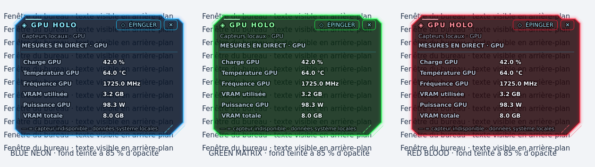

# NovaBar 0.5.3 — Holo en verre teinté et palette lisible

Les six Holo partagent un fond uni sombre teinté selon le thème, à **85 % d’opacité et 15 % de transparence**. Les tableaux et graphiques restent transparents sur cette surface commune : ils ne créent pas de rectangles gris ou blancs. L’extérieur du cadre reste transparent.

*Rendu Qt avec données de démonstration.*

## Hiérarchie des couleurs

- Valeurs en blanc glacé, libellés en gris bleuté, informations secondaires en gris discret.
- Titres, cadres et circuits dans la couleur du thème. Green Matrix ne recolore plus toutes les écritures en vert.
- Dans les modules de la barre et les fenêtres de gestion, les couleurs de texte sont conservées séparément des accents décoratifs.
- Courbe UP verte, DOWN rouge et histogramme de ping bleu, indépendamment du thème.

## Cadres

Les angles sont coupés à 45 degrés, avec un décrochement asymétrique au bord supérieur, des gardes diagonales, des traits intérieurs fins et un halo contenu. Les détails lumineux restent sur le pourtour pour laisser les données lisibles.

Les références de conception consultées sont [Neon Terminal](https://www.fab.com/listings/10aba043-46e3-4cf0-86ff-00a9e438788f) et [Sci-Fi UI](https://github.com/jonnysmillie/astro-sci-fi-ui), ainsi que l’aperçu CPU fourni pour NovaBar. Les cadres sont dessinés dans le runtime Qt.

## Vérification

77 tests locaux réussis. Vérification de l’alpha du fond (217/255), des zones extérieures transparentes, des trois teintes, de la conservation des couleurs de texte et des couleurs sémantiques du graphique. Les vues ont été rendues et inspectées sur fond clair et sombre. Les quatre builds natifs sont vérifiés par GitHub Actions avant publication des installateurs.
