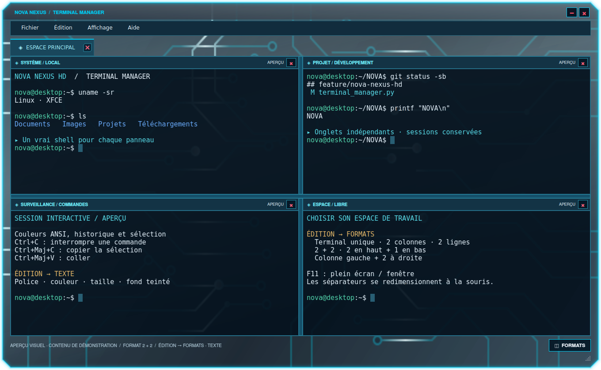
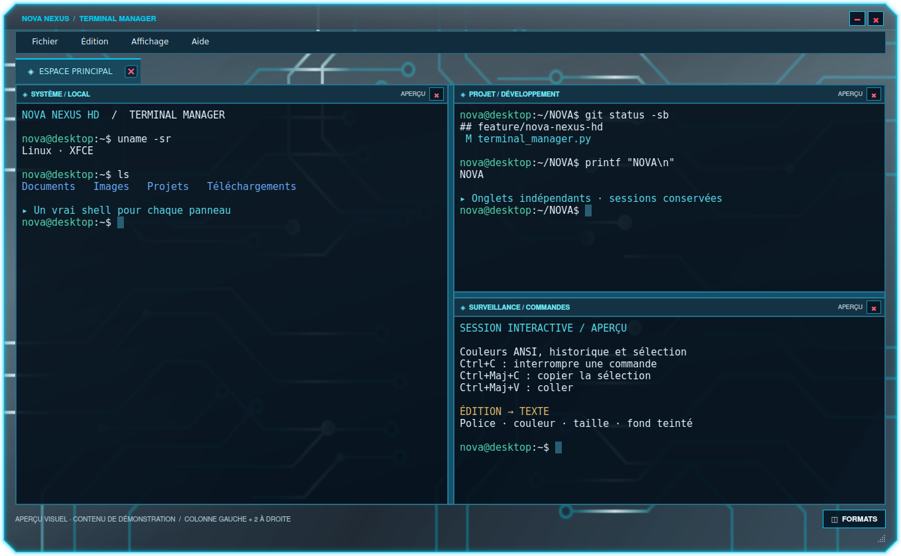

# NOVA NEXUS HD 0.7.0 — pack de bureau et gestionnaire de terminaux

Cette version réunit le runtime NovaBar 0.6.11 et la fondation NOVA NEXUS HD dans un même paquet natif. Le runtime exact est également fourni à Upgrade. Aucun téléchargement de module supplémentaire n'est nécessaire après l'installation du paquet complet.

## Composants inclus

- HUD et Holo CPU, GPU, RAM, stockage, ventilateurs, réseau et puissance.
- Huit extensions intégrées : CPU Manager/Viewer 2.1.0, Power 1.0.0 et six autres extensions 1.1.0.
- Deux panneaux latéraux, invisibles repliés et rappelés à 10 px du bord.
- Cockpit inférieur, NEXUS organisé, fenêtres et indicateurs système existants.
- Cockpit de 70 px par défaut, contre 88 px précédemment ; réglage indépendant de 60 à 112 px dans Paramètres → Docks.
- Bouton Afficher/restaurer le bureau via XFCE/X11 ; le cockpit reste visible.
- NOVA Explorer avec navigation, vues icônes/liste, recherche de noms, copie, déplacement, renommage, propriétés et corbeille GIO sous Linux. Les dossiers des panneaux s'ouvrent dans cet explorateur.
- NOVA Terminal Manager sous Linux : onglets, sessions PTY indépendantes, formats, texte configurable et même châssis que les dialogues.
- Thème GTK3/XFWM4, fond PCB et composants de dialogue/notification NOVA. Le service de notifications XFCE reste actif ; les notifications NOVA sont un aperçu local.

## Installation complète et activation

Télécharger [l'installateur Linux autonome](https://github.com/florian74410/Health-and-Perfs---Navigation-Controler-Bar/releases/download/v0.7.0/CyberNexusHUD-Linux-x86_64.run), puis le lancer sans sudo :

```bash
cd "$(xdg-user-dir DOWNLOAD)"
sh CyberNexusHUD-Linux-x86_64.run
```

L'assistant affiche les composants embarqués et permet de choisir les panneaux visibles. Cocher **Activer le bureau NOVA** pour sélectionner aussi le thème GTK3/XFWM4, ouvrir les dossiers avec NOVA Explorer par défaut et activer les deux barres et les deux colonnes. Les anciens réglages sont sauvegardés. Le système Linux et la session XFCE continuent d'assurer le fonctionnement du bureau.

Le paquet [DEB 0.7.0](https://github.com/florian74410/Health-and-Perfs---Navigation-Controler-Bar/releases/download/v0.7.0/NovaBar_0.7.0_amd64.deb) contient les mêmes composants. Après installation, l'activation globale est accessible dans **Paramètres → Bureau NOVA**.

## Depuis NovaBar 0.6.11

Utiliser **Paramètres → Upgrade**. Les réglages, profils, sources et activations des extensions sont conservés. Les capteurs intégrés manquants sont ajoutés ; une extension personnalisée ou plus récente est préservée. L'installation est vérifiée avant activation, puis seuls les anciens dossiers de runtime appartenant à NovaBar sont nettoyés. Le paquet DEB système peut rester installé comme point d'entrée ; il n'est pas désinstallé par le gestionnaire de runtimes utilisateur.

Les anciens thèmes exportés sous `NOVA-NEXUS-HD` sont copiés dans un dossier `NOVA-NEXUS-HD.previous-0.7.0` avant le nouvel export. Aucun thème tiers n'est supprimé.

## NOVA Terminal Manager

Au lancement : une fenêtre normale et un seul terminal. **Édition → Formats** propose : terminal unique, deux colonnes, deux lignes, 2 + 2, deux en haut et un en bas, une colonne à gauche avec deux terminaux à droite. Les formats divisés passent en plein écran ; F11 revient en fenêtre. Les séparateurs sont réglables. Les sessions supplémentaires restent vivantes lorsqu'un format les masque ; leur nombre est affiché.

**Édition → Texte** permet de choisir une police à chasse fixe, la taille et les couleurs du texte et du fond. Les couleurs ANSI conservent leur rôle. Les préférences sont enregistrées par utilisateur.

Raccourcis : Ctrl+Maj+T pour un onglet, Ctrl+Maj+N pour une fenêtre, Ctrl+Maj+W pour fermer l'onglet, Ctrl+Maj+C/V pour copier/coller, Ctrl+Maj+F pour rechercher dans la page affichée, Maj+Page haut/bas pour parcourir l'historique, Ctrl+C pour interrompre le programme en cours.

Cette première version utilise une émulation VT et des PTY Linux ; elle n'affirme pas une compatibilité exhaustive avec tous les modes et protocoles avancés de XFCE Terminal. Windows/macOS conservent les autres composants du pack, sans terminal PTY NOVA interactif ni remplacement XFCE.




## Restaurer les choix précédents

**Paramètres → Bureau NOVA → Restaurer les préférences précédentes** restaure les thèmes XFCE, les choix de panneaux enregistrés et le gestionnaire de dossiers précédent. Un gestionnaire de fichiers choisi ensuite manuellement est respecté. Fermer NovaBar réaffiche le panneau XFCE natif ; le mécanisme de récupération après crash est conservé.

Commandes du runtime : `--components`, `--nova-explorer [dossier]`, `--nova-terminal`, `--nova-theme install`, `--nova-theme apply`, `--nova-theme restore`, `--nova-notification-preview`. Aucun remplacement de noyau, gestionnaire de connexion ou composant d'authentification n'est effectué.
