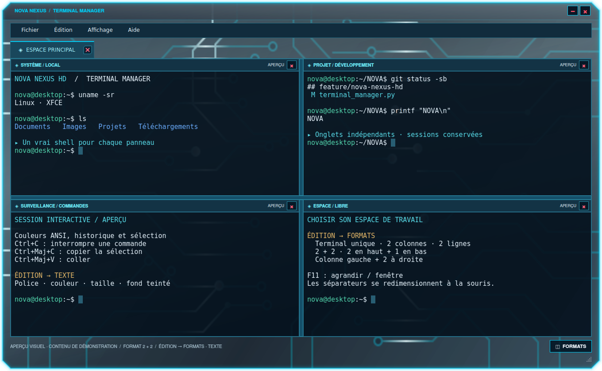

# NOVA NEXUS HD 0.7.2 — bandeau du terminal et espace du HUD

Les boutons Réduire et Fermer du Terminal Manager sont ancrés dans le bandeau graphite, indépendamment du contenu, en fenêtre normale, maximisée et lors d’une transition externe en plein écran.

Les formats divisés et F11 agrandissent le terminal dans **la zone disponible du bureau** avec son cadre et ses commandes. Le vrai plein écran des autres applications reste contrôlé par ces applications.

## Fenêtres maximisées sous XFCE/X11

NovaBar réserve la hauteur réellement occupée par le HUD supérieur. Les fenêtres déjà maximisées suivent aussi ses changements :

- HUD déployé : hauteur configurée, par exemple 70 px.
- HUD replié : 10 px, rappel au survol.
- Nouvelle épaisseur : réservation actualisée.
- HUD masqué ou fermé : réservation supprimée.
- Arrêt brutal : XFCE libère la place quand la fenêtre disparaît.

Les propriétés EWMH `_NET_WM_STRUT_PARTIAL` et `_NET_WM_STRUT` sont publiées sur la fenêtre de NovaBar, sans changer les préférences XFCE. Les coordonnées et la hauteur utilisent les pixels natifs, y compris avec la mise à l’échelle Qt. La réservation partielle suit la largeur du HUD pour les écrans disposés horizontalement. Une bordure intérieure entre deux moniteurs empilés verticalement n’est pas réservée pour éviter de bloquer le moniteur situé au-dessus. Ce mécanisme X11 ne réserve pas globalement l’espace sous Wayland.

## Installation et mise à niveau

**Paramètres → Upgrade** conserve les réglages, thèmes et extensions.

- [Installateur Linux autonome](https://github.com/florian74410/Health-and-Perfs---Navigation-Controler-Bar/releases/download/v0.7.2/CyberNexusHUD-Linux-x86_64.run)
- [Paquet Linux Mint DEB](https://github.com/florian74410/Health-and-Perfs---Navigation-Controler-Bar/releases/download/v0.7.2/NovaBar_0.7.2_amd64.deb)
- [Composants du pack et activation](UPDATE_V070.md)

