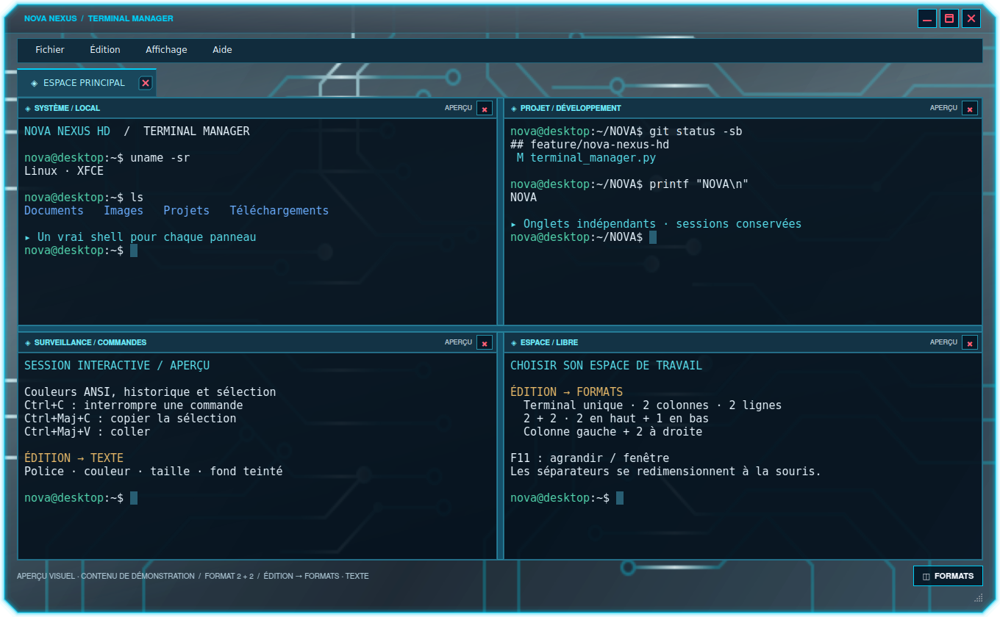
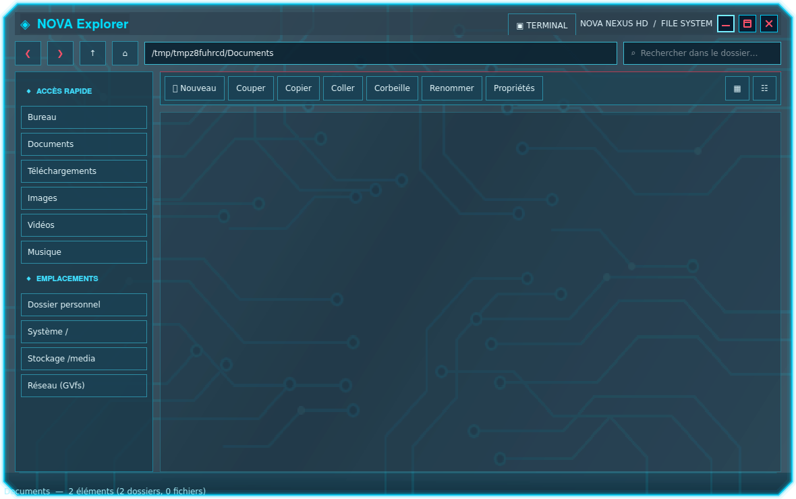

# NOVA NEXUS HD 0.7.4 — boutons de fenêtre

Les fenêtres NOVA possèdent désormais trois boutons carrés à bordure bleu électrique et symbole rouge : **minimiser**, **maximiser/restaurer** et **fermer**. Le Terminal, l’Explorateur et les boîtes de dialogue partagent ces commandes. Les symboles sont dessinés et ne dépendent pas d’une police installée.

Le thème XFWM4 fournit les cinq segments de titre, les états actif/inactif/survol/appui et le symbole de restauration. Le thème GTK3 inclut aussi ses propres icônes de barre de titre. L’activation NOVA affiche les trois commandes à droite et conserve la barre de titre des fenêtres maximisées. Les fenêtres maximisées continuent de respecter la place réservée au HUD.

## Installer le correctif

**Paramètres → Upgrade**, puis fermer et rouvrir les anciennes fenêtres NOVA. Si le thème NOVA est déjà activé depuis les paramètres, la nouvelle version réexporte ses fichiers, migre les commandes et recharge le thème XFCE sans redémarrer le gestionnaire de fenêtres. Les autres thèmes ne sont pas activés automatiquement. Pour sélectionner NOVA : **Paramètres → Bureau NOVA → Activer le bureau NOVA NEXUS HD**.

La sauvegarde existante des thèmes reste conservée. Les dispositions de boutons et la préférence de titre en maximisation sont aussi sauvegardées ; la restauration respecte les changements faits ensuite par l’utilisateur. Les applications qui dessinent entièrement leurs propres décorations, GTK4/libadwaita et les applications en véritable plein écran peuvent gérer leurs boutons indépendamment du thème XFWM4/GTK3.

[Installateur Linux complet](https://github.com/florian74410/Health-and-Perfs---Navigation-Controler-Bar/releases/download/v0.7.4/CyberNexusHUD-Linux-x86_64.run) · [Paquet DEB](https://github.com/florian74410/Health-and-Perfs---Navigation-Controler-Bar/releases/download/v0.7.4/NovaBar_0.7.4_amd64.deb)

