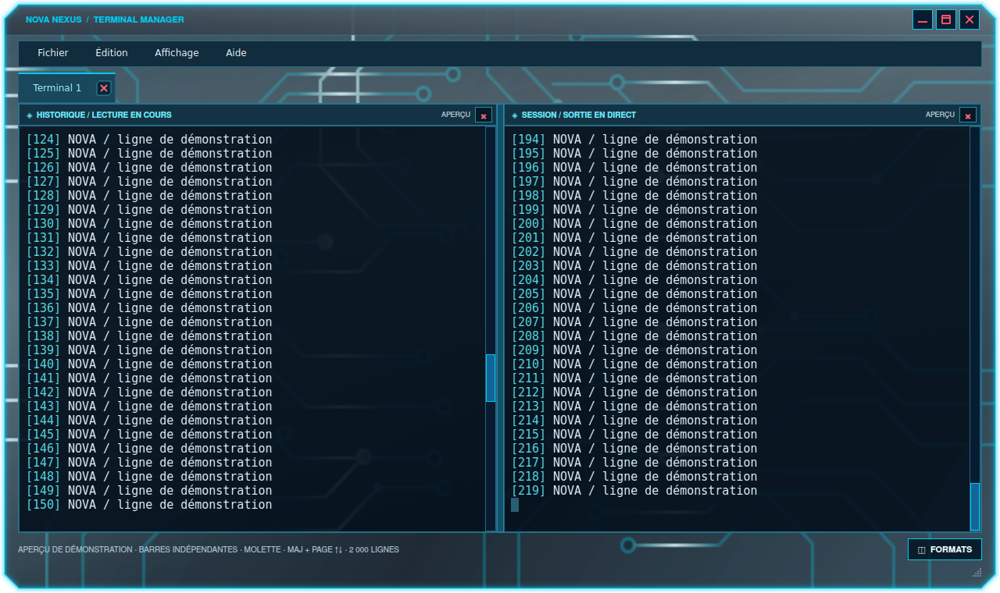

# NOVA NEXUS HD 0.7.5 — défilement des terminaux

Chaque terminal et chaque panneau fractionné dispose désormais d’une **barre verticale bleu électrique**, visible sur son bord droit. Elle parcourt le véritable historique de sa session, limité à **2 000 lignes**, en plus de l’écran courant. Les onglets et les panneaux restent indépendants.

- Glisser le curseur ou cliquer dans la piste pour parcourir les sorties précédentes.
- Utiliser la molette pour défiler ligne par ligne, ou **Maj + Page haut/bas** pour changer de page.
- **Ctrl + Maj + Début/Fin** rejoint le début de l’historique ou la sortie en direct.
- Au bas de la barre, les nouvelles lignes restent suivies automatiquement. En remontant, la position de lecture est conservée pendant l’arrivée de nouvelles sorties, jusqu’à expiration des lignes les plus anciennes dans la limite de 2 000 lignes.
- Saisir une commande ou coller du texte revient à la sortie en direct. Les touches Page haut/bas sans Maj continuent d’être transmises au programme du terminal.

Le défilement ne remplace pas l’écran actif du shell. Le rendu affiche uniquement les lignes visibles, sans reconstruire 2 000 lignes HTML à chaque mise à jour. Les préférences de police et de couleur conservent la barre de défilement.

## Mise à jour

**Paramètres → Upgrade**, puis ouvrir une nouvelle fenêtre NOVA Terminal. Les fenêtres de terminal déjà ouvertes continuent d’utiliser leur ancienne version jusqu’à leur fermeture. Profils, plugins et préférences de texte sont conservés. Les boutons de fenêtre et la réservation de place du HUD de la version 0.7.4 sont inclus.

[Installateur Linux complet](https://github.com/florian74410/Health-and-Perfs---Navigation-Controler-Bar/releases/download/v0.7.5/CyberNexusHUD-Linux-x86_64.run) · [Paquet DEB](https://github.com/florian74410/Health-and-Perfs---Navigation-Controler-Bar/releases/download/v0.7.5/NovaBar_0.7.5_amd64.deb)

