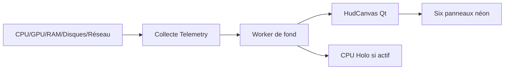
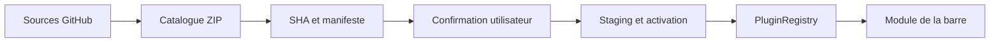

# 🏗️ Architecture technique

> Une application Qt/Python locale, un collecteur de mesures et une interface de plugins déclaratifs.

[🏠 Accueil](Home.md) · [🚀 Démarrage](Premiers-pas.md) · [📦 Installation](Installation.md) · [🎛️ Interface](Interface.md) · [🔌 Plugins](Plugins.md) · [🛠️ Dépannage](Depannage.md)

---

## 🧱 Les couches principales

| Fichier / module | Mission |
|---|---|
| `app.py` | Fenêtre NovaBar, raccourcis, barre, menu, commandes et cycle d'interface |
| `hud.py` | Dessin vectoriel Qt/Painter, grilles adaptatives, couleur, géométrie des modules |
| `holo.py` / `cpu_detail.py` | Vue CPU CORE MATRIX et topologie/sondes par cœur |
| `telemetry.py` | Collecte locale non bloquante via `psutil`, `nvidia-smi` et sondes disponibles |
| `config.py` / `profiles.py` | Validation, réglages JSON, profil local et espaces Documents |
| `plugin_manager.py` / `plugins.py` | Interface 2 onglets, validation manifeste, activation et retour arrière |
| `plugin_sources.py` | Catalogue GitHub public HTTPS et récupération sécurisée de ZIP |
| `install_engine.py` / `updates.py` | Autotest des runtimes, activation, vérification des versions |
| `autostart.py` / `hotkeys.py` | Démarrage de session et clavier selon l'OS |

## ⛓️ Flux d'une mesure

Le worker évite de bloquer les animations de l'interface. La fréquence des sondes et le rythme du rendu sont dissociés. Les données inaccessibles sont indiquées par **—**.

## 🧩 Flux d'un plugin

Le registre accepte les manifestes API v1/v2 **déclaratifs** selon la capacité du runtime. Les plugins ne sont pas des programmes Python téléchargés puis exécutés librement. Certaines vues sont codées dans NovaBar ; l'activation d'un plugin déclare le branchement à une vue prévue.

## 🎨 Surface d'affichage

NovaBar est une fenêtre Qt transparente (`WA_TranslucentBackground`) maintenue au premier plan lorsque l'OS le permet. Les modules sont peints avec une opacité configurable. Les fenêtres Holo sont distinctes. Pour l'instant, l'application n'emploie pas de protocole layer-shell Wayland ; les garanties d'ancrage diffèrent selon le compositeur.

## 🧪 Validation

Le projet utilise des tests Python, des rendus Qt `offscreen` et des builds GitHub Actions pour Linux, Windows et macOS. **Une CI verte ne remplace pas** les essais sur véritables GPU, cartes mères et sessions de bureau. [Consulter la procédure de dépannage](Depannage.md).

---

⚡ NovaBar • CYBER NEXUS HUD · Les illustrations sont documentaires, les fonctions non livrées sont signalées.
