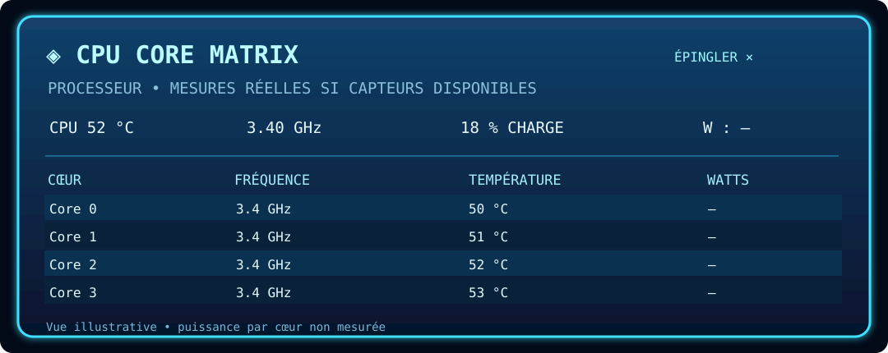

# 🧠 Holo CPU — CORE MATRIX

> Une fenêtre holographique pour détailler les mesures par cœur, sans altérer la barre principale.

[🏠 Accueil](Home.md) · [🚀 Démarrage](Premiers-pas.md) · [📦 Installation](Installation.md) · [🎛️ Interface](Interface.md) · [🔌 Plugins](Plugins.md) · [🛠️ Dépannage](Depannage.md)

---

## Comment l'ouvrir ?

1. Allez dans **Extensions → Plugins**.
2. Installez le plugin **CPU Manager / Viewer** (`cpu-manager-viewer`) depuis le catalogue officiel ou un ZIP valide.
3. Activez ce plugin, puis cliquez sur le module **CPU** de NovaBar.
4. Fermez la fenêtre Holo avec **✕** ou utilisez **Épingler** pour maintenir son affichage.

La fenêtre Holo peut s'ancrer près du module CPU et se repositionner lorsque la barre change d'écran ou de taille. Elle ne constitue pas une transformation de tous les modules.

## Données affichées

- Identité du processeur, nombre de cœurs physiques et threads si disponibles.
- Température, fréquence, charge et puissance CPU **si la sonde fournit ces mesures**.
- Fréquences et températures détaillées par cœur lorsque la topologie et les mesures du système le permettent.
- **—** en cas de fréquence, de température ou de puissance individuelle inconnue.

**Important :** Intel RAPL fournit une puissance totale de package, et le logiciel ne calcule **pas** de watts fictifs pour chaque cœur. La topologie physique peut être inconnue sur certains systèmes.

## Et le GPU Holo ?

Pour l'instant, le runtime ne connaît **qu'une vue Holo native CPU CORE MATRIX**. Des fenêtres natives GPU/RAM/SSD complètes appartiennent aux évolutions futures, pas aux fonctions livrées.

---

NovaBar • CYBER NEXUS HUD • Documentation maintenue dans le dépôt. Les illustrations utilisent des valeurs d'exemple ; les sondes réelles dépendent du système et du matériel.
