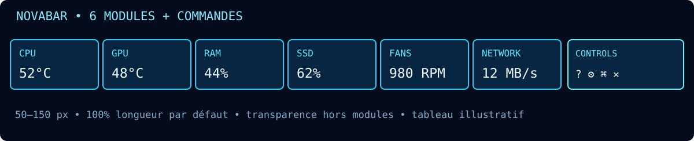
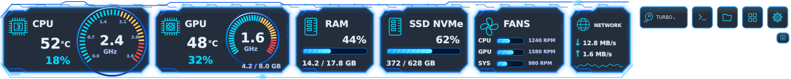
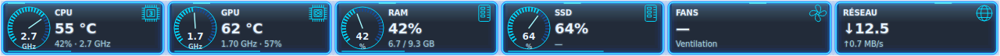
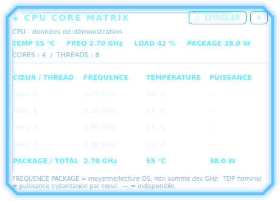

# 🎛️ Interface et contrôles

**0.7.3 :** [ouvrir NOVA Terminal depuis le HUD et les panneaux](../UPDATE_V073.md). Le bouton du HUD ouvre maintenant le terminal dans son thème ; les scripts restent dans le menu contextuel.

**0.7.2 :** [HUD et fenêtres maximisées, terminal dans la zone disponible](../UPDATE_V072.md). Le HUD replié occupe 10 px ; les commandes du terminal restent dans son bandeau graphite.

**0.7.1 — NOVA NEXUS HD :** [installation complète, activation/restauration du bureau, Explorer et Terminal Manager](../UPDATE_V070.md). Depuis 0.6.11, utiliser **Paramètres → Upgrade**, puis **Bureau NOVA** pour l'activation globale. Les notifications NOVA restent un aperçu local.

> Une barre ultra-fine sur le bureau, transparente en dehors des modules et responsive.

[🏠 Accueil](Home.md) · [🚀 Démarrage](Premiers-pas.md) · [📦 Installation](Installation.md) · [🎛️ Interface](Interface.md) · [🔌 Plugins](Plugins.md) · [🛠️ Dépannage](Depannage.md)

---

## 📐 Géométrie du HUD

| Élément | Valeurs acceptées | Valeur initiale |
|---|---|---|
| Épaisseur | **50–150 px** | 72 px |
| Longueur | 25–100 % du bord | 100 % |
| Position | Haut / Bas / Gauche / Droite | Haut |
| Alignement | Gauche / Centre / Droite | Centre |
| Opacité des fonds | 0–100 % | 88 % |
| Rétractation | Activée ou désactivée, délai 3–120 s | 15 s |
| Actualisation des capteurs | 1–30 s | 2 s |

Les modules conservent leur géométrie proportionnelle : à faible largeur, la disposition s'adapte. Le fond hors panneaux est transparent. L'application ne réserve pas actuellement d'espace de travail comme une barre de tâches : les fenêtres plein écran et certains compositeurs peuvent la recouvrir.

## 🧭 Boutons

**TURBO⌄** : modes CPU Linux lorsque le noyau et les permissions le permettent ; voir [CPU Mode et limites](CPU-Mode.md). Aucun contrôle PWM ni overclocking universel. **Console** : menu de scripts locaux du dossier choisi ; confirmation nécessaire avant exécution. **Dossier** : configuration ; **Extensions** : Plugin Control Center ; **Préférences** : réglages ; **? Wiki** : documentation GitHub dans le navigateur (v0.3.6+) ; **⤢** : hauteur ; **✕** : quitter.

Un menu contextuel et l'icône système proposent les actions importantes. Les modules peuvent être réordonnés par glisser-déposer. Le clic sur le logo en haut à droite de chaque plugin actif ouvre ou ferme son Holo ; le survol et le clic sur les valeurs ne l’ouvrent pas.

## ⌨️ Raccourcis

- **Ctrl+B** : afficher / masquer (raccourci par défaut).
- **Ctrl+Q** : quitter.
- Les raccourcis personnalisables comprennent l'affichage, les préférences et l'agrandissement. Leur capture globale dépend des permissions X11 / Windows / macOS ; sur Wayland, une variante locale peut être utilisée.

---

NovaBar • CYBER NEXUS HUD • Documentation maintenue dans le dépôt. Les illustrations utilisent des valeurs d'exemple ; les sondes réelles dépendent du système et du matériel.

## NovaBar 0.4 · Holo et thèmes

Trois thèmes partagent le même kit UI : Blue Neon, Green Matrix, Red Blood.
Les traces PCB parcourent toute la fenêtre et la puce NovaBar occupe l’espace des actions.
Chaque **logo en haut à droite du plugin** est le seul déclencheur du Holo.
Un clic ouvre les détails du plugin activé, un second clic ferme. Aucun survol ni clic sur les valeurs ne l’ouvre.
CPU, GPU, RAM, SSD, FANS et NETWORK ont un panneau ; les données manquantes restent « — ».
La flèche vers le haut minimise manuellement. Le bord de l’écran et la zone de notification révèlent la barre.
Paramètres propose Always visible, Auto retract et Manual retract only, ainsi qu’un onglet Wiki.
Always visible désactive le repli temporisé ; la flèche reste une commande manuelle explicite.

## Nouveautés 0.5.1

Les compte-tours CPU/GPU affichent les GHz, et les cadrans RAM/SSD affichent le pourcentage. Ils restent circulaires à toutes les hauteurs ; les valeurs sont prioritaires lorsque l’espace est trop réduit pour un cadran.

Les Holo CPU (460 × 330 px) et capteurs (380 × 280 px) sont compacts, transparents jusque dans leurs tableaux et défilants. Le réglage d’opacité des modules ne remet aucun fond opaque dans les Holo.

*Les captures utilisent des mesures de démonstration ; leur transparence est conservée dans les fichiers PNG.*

## Graphique réseau et contraste — 0.5.2

Le texte est dessiné avec un contour sombre et un intérieur néon, sans fond opaque. Le Holo Réseau contient deux courbes, **UP verte** et **DOWN rouge**, et un **histogramme bleu de ping**. L’échelle de débit est à gauche, le ping en ms à droite. Le réseau conserve son historique de 120 secondes lorsque le Holo est fermé. Le panneau mesure 460 × 360 px ; les autres panneaux gardent leur format compact.

[Guide 0.5.2](../UPDATE_V052.md)

## Style Holo 0.5.3

Les six panneaux ont maintenant un **fond uni sombre à 85 % d’opacité**, teinté selon le thème. Les tableaux et graphiques partagent ce fond. Les cadres néon fins ont des angles biseautés et des détails diagonaux. Les valeurs sont blanches, les libellés gris bleuté et les titres accentués ; Green Matrix ne recolore plus toutes les écritures en vert. Les couleurs du réseau restent UP vert / DOWN rouge / ping bleu.

*Données de démonstration. [Guide 0.5.3](../UPDATE_V053.md).*
