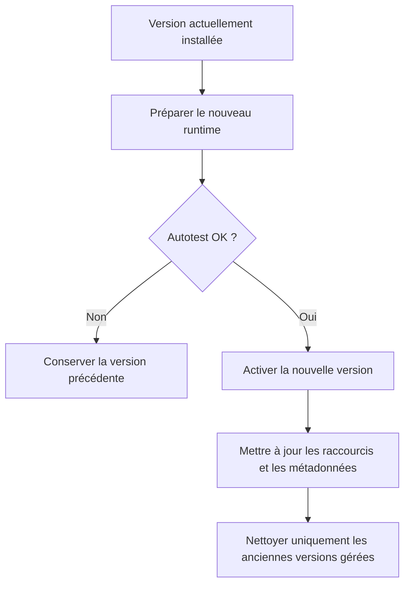

> **0.6.11 :** la refonte du cockpit conserve le moteur Upgrade de la 0.6.10. Depuis la 0.6.10, utiliser **Paramètres → Upgrade**.

# 🔄 Mises à jour et sauvegardes

> La priorité est de ne pas détruire une installation saine ni les plugins locaux.

[🏠 Accueil](Home.md) · [🚀 Démarrage](Premiers-pas.md) · [📦 Installation](Installation.md) · [🎛️ Interface](Interface.md) · [🔌 Plugins](Plugins.md) · [🛠️ Dépannage](Depannage.md)

---

## Upgrade depuis NovaBar

Dans la 0.6.10, cliquer **Paramètres → Upgrade • mise à jour automatique** lance la vérification, le téléchargement du runtime officiel adapté à la machine, la vérification SHA-256, son autotest isolé et l’activation. NovaBar redémarre automatiquement. Une erreur reste affichée et l’ancienne version n’est pas désinstallée.

**Depuis la 0.6.9 déjà installée :** utiliser **Mises à jour… → Vérifier → Installer → Redémarrer** une première fois. Le téléchargement se fait dans NovaBar. Le nouveau bouton Upgrade apparaît après ce passage à la 0.6.10.

Les profils, thèmes, raccourcis et plugins sont conservés. L’installation est par utilisateur, sans `sudo`. Les raccourcis Linux sont actualisés pour lancer le nouveau runtime. La version du paquet enregistrée par `dpkg` reste inchangée ; un ancien `/usr/bin/novabar` du DEB 0.6.9 garde sa version. Pour remplacer aussi cette copie système, installer le nouveau DEB. Pour une installation Flatpak gérée, privilégier le gestionnaire Flatpak.

## 📦 Selon votre installateur

| Mode | Mise à jour | Nettoyage |
|---|---|---|
| **.deb** | Installer le nouveau `.deb` avec `apt` | Fichiers du paquet remplacés ; profil conservé |
| **Flatpak** | Installer un bundle plus récent | Le gestionnaire Flatpak garde son modèle de versions |
| **.run** | Télécharger le nouveau lanceur et l'exécuter | Le nouveau runtime est d'abord testé ; nettoyage des anciennes versions gérées |
| **Windows** | Nouveau setup portant le même AppId | Lanceur remplacé, runtime versionné |
| **macOS** | Nouveau DMG ou mise à jour intégrée disponible | Respecter le processus de l'OS |

Les paquets `.deb` et Flatpak **n'effacent pas** un ancien runtime géré par `.run` : désinstallez manuellement cette copie si vous migrez définitivement, après sauvegarde de votre profil.

## 🛡️ Installation transactionnelle du runtime autonome

Une version encore utilisée et verrouillée peut rester en place. Le nettoyage ne doit jamais parcourir arbitrairement les dossiers utilisateur.

## 💾 Ce qui ne doit pas disparaître

- Les profils dans `Documents/NovaBar/App/Profiles` et `Profiles`.
- Le catalogue et la configuration des sources GitHub.
- Les ZIP/plugins dans `Documents/NovaBar/Plugins`.
- Les préférences locales du compte et les thèmes utilisateur.

## 🔎 Vérifier un téléchargement

Pour le fichier `.run` : `sh CyberNexusHUD-Linux-x86_64.run --check`. Pour les autres paquets, consultez `Executable/SHA256SUMS` et `Executable/manifest.json`. Une empreinte permet de constater une corruption, mais ne remplace **pas** une signature d'éditeur indépendante.

[📦 Ouvrir les téléchargements](../../Executable/README.md)

---

⚡ NovaBar • CYBER NEXUS HUD · Les illustrations sont documentaires, les fonctions non livrées sont signalées.
